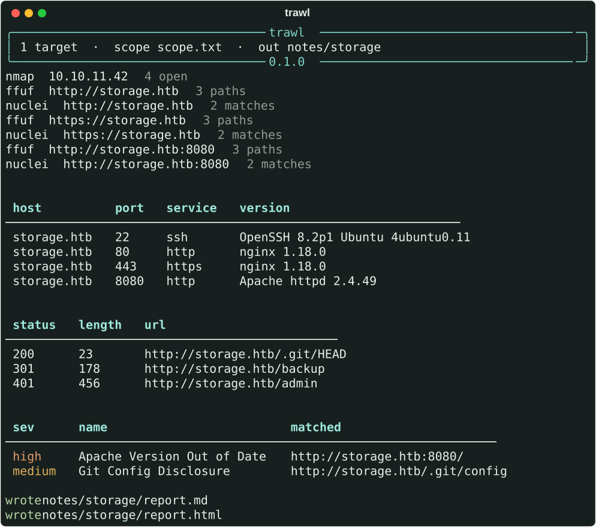
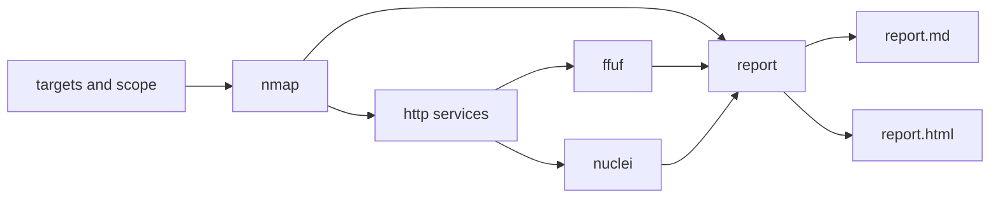

# trawl

[](https://github.com/WastedPatriot/trawl/actions/workflows/ci.yml)
[](https://www.python.org/)
[](LICENSE)

nmap, then ffuf on anything that speaks HTTP, then nuclei. One report at the end, instead of three files called `final2`.

Written while revising for HTB CPTS. It will not pass the exam for you. It will keep a box's notes in one place, which is a lower bar, and still the bar I kept tripping over.



That picture is the real UI. The box is made up: `storage.htb` on a lab range, with scanner output that was already sitting on disk. The README shouldn't need nmap installed just to exist. A dry-run, below, prints the commands trawl would actually exec.

## Quick start

```bash
python -m venv .venv
source .venv/bin/activate
pip install -e .
```

nmap, ffuf and nuclei are not Python packages. Install them the way you usually do. If one isn't on `PATH`, trawl says so and carries on with the others. A missing ffuf shouldn't cost you the nmap results.

```bash
trawl 10.10.11.42 --scope scope.txt --wordlist common.txt \
  --http-ports 80,443 --dry-run -o notes/storage
```

```text
╭───────────────────────────────────────── trawl ──────────────────────────────────────────╮
│ 1 target  ·  scope scope.txt  ·  out notes/storage  ·  dry run                           │
╰───────────────────────────────────────── 0.1.0 ──────────────────────────────────────────╯
nmap -Pn -sV --top-ports 1000 -T4 -oX notes/storage/nmap/10.10.11.42.xml 10.10.11.42
ffuf -u http://10.10.11.42/FUZZ -w common.txt -t 40 -of json -o notes/storage/ffuf/http___10.10.11.42.json -noninteractive -mc 200,204,301,302,307,401,403 -fc 404 -e .php,.html,.txt
nuclei -target http://10.10.11.42 -jsonl -output notes/storage/nuclei/http___10.10.11.42.jsonl -silent -no-color -disable-update-check -severity medium,high,critical -rate-limit 150
ffuf -u https://10.10.11.42/FUZZ -w common.txt -t 40 -of json -o notes/storage/ffuf/https___10.10.11.42.json -noninteractive -mc 200,204,301,302,307,401,403 -fc 404 -e .php,.html,.txt
nuclei -target https://10.10.11.42 -jsonl -output notes/storage/nuclei/https___10.10.11.42.jsonl -silent -no-color -disable-update-check -severity medium,high,critical -rate-limit 150
```

Dry-run can't see the future, so it only prints ffuf and nuclei when you already know the web ports (a URL, or `--http-ports`). Otherwise you get the nmap line and a note that the web tools wait their turn. It does not create the output directory, and it still refuses anything outside the scope file.

## A normal evening

```bash
# one box, notes in the box folder
trawl 10.10.11.42 storage.htb --scope ~/htb/storage/scope.txt -o ~/htb/storage/trawl

# you already know it's a website
trawl http://storage.htb --skip nmap --wordlist ~/wordlists/common.txt

# a short list, and only the findings worth reading twice
trawl -t targets.txt --scope scope.txt --severity high,critical
```

`--help` is short. Ping is off by default, because HTB boxes enjoy pretending they're dead. `-sC` is off too; pass `--scripts` when you actually want default NSE. nuclei starts at medium, so the report isn't 200 missing headers, and its update check is off so a lab run doesn't wander off to the internet.

ffuf threads default to 40, which is polite-ish. The wordlist defaults to the SecLists `common.txt` path on Kali. If that file isn't there, ffuf is skipped and the path is named.

## What the report looks like

Markdown for the notes app, HTML for the thing you open. The HTML is one file, no assets, so it still works on a train.

```markdown
# trawl report

- generated: 2026-11-11 12:48 UTC
- targets: `10.10.11.42`
- 4 open ports · 3 paths · 2 template matches

## Hosts

### storage.htb

`10.10.11.42` · up

| port | proto | service | version |
| --- | --- | --- | --- |
| 22 | tcp | ssh | OpenSSH 8.2p1 Ubuntu 4ubuntu0.11 (Ubuntu Linux; protocol 2.0) |
| 80 | tcp | http | nginx 1.18.0 |
| 443 | tcp | https | nginx 1.18.0 |
| 8080 | tcp | http | Apache httpd 2.4.49 |

## Web

| status | length | words | url |
| --- | --- | --- | --- |
| 200 | 23 | 2 | `http://storage.htb/.git/HEAD` |
| 401 | 456 | 28 | `http://storage.htb/admin` |

## Templates

### high · Apache Version Out of Date

- template: `apache-outdated-version`
- matched: `http://storage.htb:8080/`

The Server header says Apache 2.4.49, which is older than anyone wants in a lab writeup.
```

Closed and filtered ports are dropped. They were nmap saying "move on".

## How it hangs together



Each tool is a subprocess, argv as a list, never a shell string. Output is parsed from nmap's XML, ffuf's JSON, and nuclei's JSONL. Same URL twice in one run is kept once.

<details>
<summary>Where the files go</summary>

```text
notes/storage/
  nmap/10.10.11.42.xml
  ffuf/http___storage.htb.json
  nuclei/http___storage.htb.jsonl
  report.md
  report.html
```

One ffuf and one nuclei per web base. `http://storage.htb` and `http://storage.htb:8080` are different bases. Port 443 with an ssl tunnel is treated as https even when nmap labelled the service `http`.

</details>

<details>
<summary>Scope file</summary>

One entry per line. Blanks and `# comments` are ignored.

- `10.10.11.0/24` covers addresses in that range, and smaller ranges inside it
- `10.10.11.42` covers that address
- `storage.htb` covers that name, in any case
- `*.htb` covers `storage.htb` and `a.b.htb`, not `htb`, and not `nothtb`

Names and addresses are matched as written. trawl does not resolve DNS, so a hostname is not secretly inside a CIDR. Put both in the file if you scan both.

Anything outside the file is refused, including on `--dry-run`. Set `require_scope = true` in the config if you want trawl to refuse to run with no scope file at all.

</details>

## Config

`./trawl.toml`, or `~/.config/trawl/config.toml`, then flags on top. There's a copy-pasteable [`trawl.toml.example`](trawl.toml.example). A key it doesn't recognise is an error. Typos shouldn't be silent.

## Tests

`pytest` and `ruff`. The tests feed the parsers saved nmap, ffuf and nuclei output from `tests/fixtures`. CI does the same. Nothing in GitHub Actions is a scanner.

<details>
<summary>If the box is dull, and other small jokes</summary>

An empty haul prints `nothing in the nets today`, in the terminal and in the report. If one tool came back empty and the others didn't, that tool gets the sentence to itself.

There's a flag that isn't in `--help`. It is not a scanner.

The HTML report, and the markdown one, end with an HTML comment. That's the whole of it.

</details>

## Roadmap

- more than one target at a time, instead of a polite queue
- pick up a half-written output directory instead of starting again
- a JSON report, for the people who grep
- rustscan or masscan as the noisy first pass, when top-1000 is too polite

## Before you point it at anything

[ETHICS.md](ETHICS.md). Machines you own, a lab you were given, or an HTB box on the HTB network. The scope file is a seatbelt, not a lawyer.

MIT, see [LICENSE](LICENSE).
